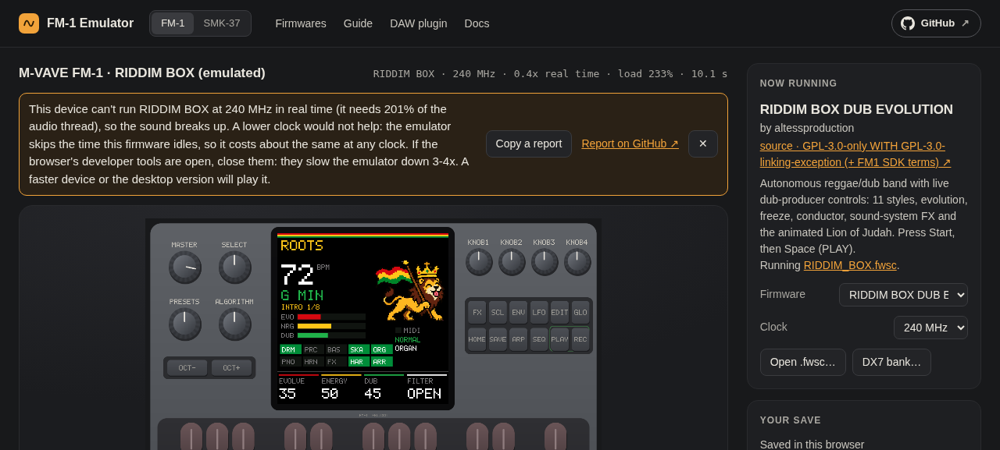
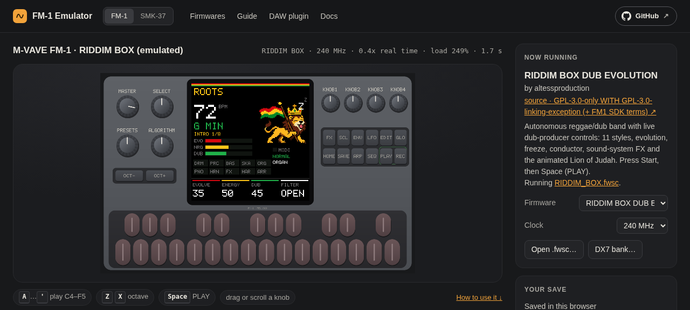
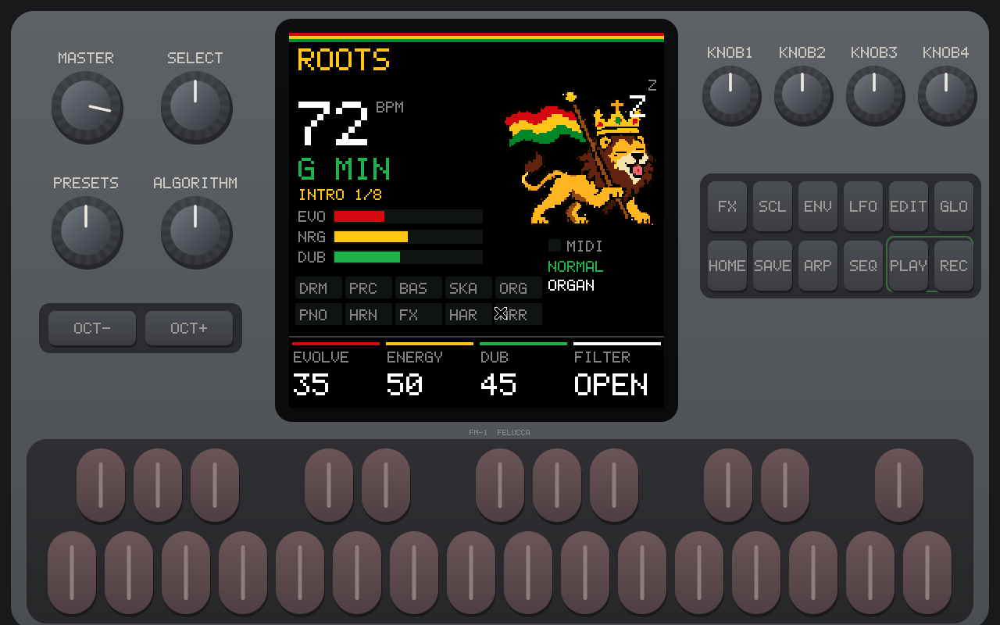
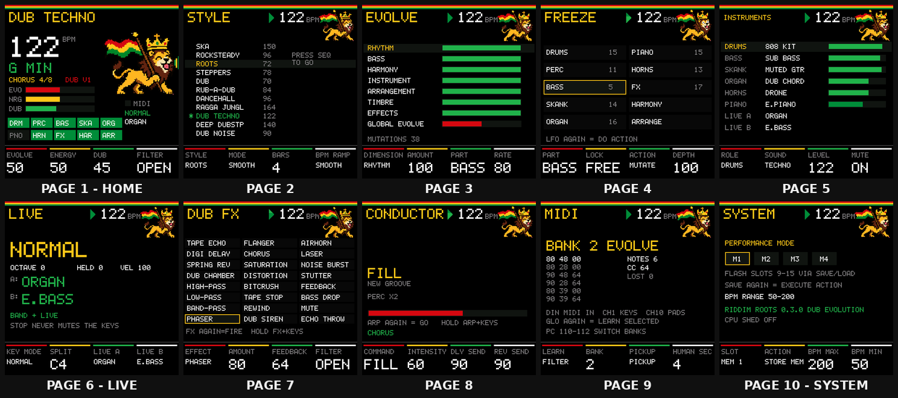
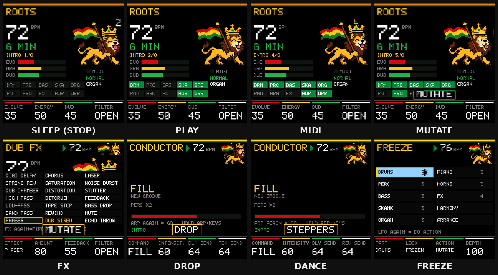

# RIDDIM BOX FM-1

**RIDDIM BOX** — firmware reggae/dub génératif pour le **M-VAVE FM-1**, exécutable ici même dans votre navigateur, installable sur la vraie machine.

## ▶ Ouvrir l'émulateur · ▶ Installer sur la pédale

**[▶ Ouvrir l'émulateur](https://altessproduction.github.io/RIDDIM-BOX-FM1/demo/emulator/)** — RIDDIM BOX se lance directement dans le navigateur, firmware chargé automatiquement.

**[⬇ Installer RIDDIM BOX sur votre FM-1](https://altessproduction.github.io/RIDDIM-BOX-FM1/firmware/RIDDIM_BOX_update.html?lang=fr#update)** — page d'installation **en français**, ouverte directement sur le bon onglet. Compatible avec toutes les pédales d'origine : **V14, V15 et V16**. Utilisez Chrome ou Edge, pédale allumée connectée en USB ; procédure complète plus bas. *(La page d'accueil du dépôt [redirige aussi vers l'émulateur](https://altessproduction.github.io/RIDDIM-BOX-FM1/).)* En local : `python -m http.server 8765` à la racine du dépôt, puis ouvrir <http://localhost:8765/>.



Firmware : `firmware/RIDDIM_BOX.fwsc` (483 892 octets)
SHA-256 : `aaffff6bda64348b8cdc691f9bb85549c409e1c6f51f0a87320d01db34d9b894`
Page d'installation : [**⬇ Installer sur votre FM-1**](https://altessproduction.github.io/RIDDIM-BOX-FM1/firmware/RIDDIM_BOX_update.html?lang=fr#update) — SHA-256 `0932344e802303512d6534e81b7118ccad91107cc0bb73a54f3ae0bb7b988946` (interface française, notice V14/V15/V16 intégrée)

---

## Essayer maintenant — sans rien installer

L'émulateur FM-1 (fm1-emu) exécute **le vrai package `.fwsc`**, octet pour octet celui qui s'installe sur la machine réelle : le CPU PI32v2, l'écran 240×240, les touches, les encodeurs, le MIDI et l'audio sont émulés en WebAssembly. Aucune recompilation, aucune réécriture : c'est le firmware d'origine qui tourne.

- **En ligne** : [altessproduction.github.io/RIDDIM-BOX-FM1](https://altessproduction.github.io/RIDDIM-BOX-FM1/) (redirection automatique vers l'émulateur) ;
- **En local** : `python -m http.server 8765` à la racine du dépôt, puis <http://localhost:8765/> (ou `demo/emulator/` directement).

Démarrage : bouton **Start** → clavier du PC (`A`…`'` = C4–F5, `Z`/`X` = octave, **Espace** = PLAY, `1–0` = FX/SCL/ENV/LFO/EDIT/GLO/HOME/SAVE/ARP/SEQ, flèches = SELECT/PRESETS/ALGORITHM), souris/tactile pour les boutons et potards, ou un clavier MIDI (Web MIDI, Chrome/Edge/Firefox).

À l'arrêt, l'écran HOME affiche le style, le tempo, la tonalité, la section d'arrangement et les jauges EVOLVE / ENERGY / DUB / FILTER ; le Lion de Judah dort (`Zzz`). Sur PLAY, le groupe entre en scène et le lion se réveille. Le bandeau de démarrage et la page SYSTEM affichent le nom du firmware : **RIDDIM BOX**.

| À l'arrêt (lion endormi) | En lecture (lion éveillé) |
|---|---|
|  |  |

> **Note performances** : l'horloge émulée est réglable de 60 à 240 MHz (vitesse réelle : 240 MHz). Sur un ordinateur portable récent, l'émulateur tourne plus vite que le temps réel. Sur une machine lente, le son se hache : baisser l'horloge n'aide pas (le firmware utilise le temps d'inactivité), il faut une machine plus rapide — voir la section **[Émulateur sur votre PC](#émulateur-sur-votre-pc--quelle-version-choisir)** plus bas.

---

## Émulateur sur votre PC — quelle version choisir ?

RIDDIM BOX est le firmware le plus lourd du catalogue FM-1 (deux cœurs PI32v2 quasi saturés à 240 MHz). L'émulateur navigateur (JIT WebAssembly) demande l'équivalent d'environ **deux cœurs de processeur modernes** pour le faire tourner en temps réel. Options mesurées :

| Version | PC récent (2 cœurs modernes+) | PC ancien 4 cœurs / 8 Go | Remarques |
|---|---|---|---|
| **Navigateur** (cette page) | temps réel (~1–2×) | ~0,3× — son haché | le plus simple ; fermer les DevTools (ils ralentissent ×3–4), bouton « audio buffer » plus grand si proposé |
| **fm1-live** desktop natif 0.5.0 | interface partout, audio temps réel sur machine rapide | interface ok, audio haché | **pas encore de JIT x86-64** (interpréteur ¼–½ de la vitesse JIT ; JIT annoncé pour la 0.6) |
| **FM-1.vst3 / FM-1.clap** (plugin DAW) | temps réel en DAW sur machine rapide | non | même moteur que fm1-live |
| **fm1-emu** (batch, hors ligne) | génère WAV + captures BMP hors ligne | possible mais lent (~0,01× sur serveur rapide) | pour produire un fichier audio sans jouer en direct |
| **La vraie pédale FM-1** | 240 MHz natifs, aucune limite | — | la voie garantie : [⬇ Installer sur votre FM-1](https://altessproduction.github.io/RIDDIM-BOX-FM1/firmware/RIDDIM_BOX_update.html?lang=fr#update) |

**Concrètement :**
- **PC modeste** : l'interface se teste intégralement (écran, 10 pages, lion, touches, MIDI) ; pour **entendre** la musique en temps réel, utilisez une machine récente, un **smartphone récent** (Chrome Android fait tourner l'émulateur web) ou flashez la vraie pédale.
- **fm1-live / plugin** (MIT, [fm1-emu 0.5.0](https://github.com/joakimeriksson/fm1-emu/releases)) : [fm1-plugin-0.5.0-windows-x86_64.zip](https://github.com/joakimeriksson/fm1-emu/releases/download/v0.5.0/fm1-plugin-0.5.0-windows-x86_64.zip) — SHA-256 `de683f4469a27e17c210d12b0a82e84776c38777c09bf3998da75d8c21de0bf2` (contient `FM-1.vst3`, `FM-1.clap` et `INSTALL.txt`) ; builds standalone Linux/macOS : `fm1-emu-0.5.0-*.tar.gz`. Testé ici avec ce firmware : `./fm1-live --fwsc RIDDIM_BOX.fwsc`.
- **Rendu audio hors ligne** (fm1-emu batch) : `./fm1-emu --fwsc RIDDIM_BOX.fwsc --ms 60000 --keys '2600-2650:pot:900,3000-3100:PLAY' --wav demo.wav --snap 5000,30000` — produit 60 s de musique et deux captures de l'écran, sans jouer en direct.



---

## Contenu du dépôt

| Chemin | Contenu |
|---|---|
| `firmware/RIDDIM_BOX.fwsc` | Le firmware (package de mise à jour complet, avec chargeur d'origine) |
| `firmware/RIDDIM_BOX_update.html` | Page d'installation hors-ligne (voir plus bas) |
| `firmware/SHA256SUMS.txt` | Empreintes de contrôle du firmware et de la page d'installation |
| `demo/emulator/` | Émulateur FM-1 dans le navigateur + le firmware (GitHub Pages ready) |
| `docs/audit_riddim_box_fm1.pdf` | Audit technique complet : flash, RAM, CPU-audio, installation, plan d'optimisation |
| `docs/figs/` | Figures de l'audit (budgets flash/RAM, carte de la flash 1 Mo) |
| `docs/img/` | Captures d'écran LCD du firmware réel (10 pages de l'UI, 8 poses du lion) |
| `LICENSE.md`, `THIRD_PARTY.md` | Licences (GPL-3.0 + exception SDK ; composants tiers) |

---

## Les fonctions du firmware

### Un groupe reggae génératif, jouable comme un dub mixer

Six musiciens virtuels — **drums + percussion, basse, skank, orgue, cuivres/lead, piano** — improvisent en continu, guidés par un moteur d'harmonie et un arrangeur qui déroule des sections **INTRO / VERSE / CHORUS / DUB / BREAK / BUILD / DROP / OUTRO**. La musique ne s'arrête jamais : changer de style, de tempo, de son ou de page se fait en jouant.

### 11 styles, du ska au dub noise

Chaque style a ses propres grammaires rythmiques, kits, timbres, mixage et espace stéréo. Tempos mesurés sur le firmware réel :

| Style | BPM | Style | BPM |
|---|---|---|---|
| SKA | 150 | DANCEHALL | 96 |
| ROCKSTEADY | 96 | RAGGA JUNGLE | 164 |
| ROOTS | 72 | DUB TECHNO | 122 |
| STEPPERS | 78 | DEEP DUBSTEP | 140 |
| DUB | 70 | DUB NOISE | 90 |
| RUB-A-DUB | 84 | | |



### Transitions de style sans jamais appuyer sur STOP

Cinq plans de transition : **SMOOTH, DUB MIX, BREAK, HARD SWITCH, MUTANT**, sur 1 à 16 mesures, avec plan de tempo double-time / half-time — ROOTS 72 BPM peut rejoindre RAGGA JUNGLE 164 BPM sans casser le pouls (le tempo glisse mesure par mesure, vérifié sur l'émulateur : 122 → 127 → 132 → 139 → 143 → 153 → 156 → 164).

### EVOLVE — l'évolution contrôlée du morceau

Un réglage global **EVOLVE 0–100** pilote sept dimensions indépendantes : **rythme, basse, harmonie, instrument, arrangement, timbre, FX**. À 0 le motif est constant ; à 100 chaque phrase peut muter. La famille d'actions live complète :

- **FREEZE** : gèle une ou plusieurs dimensions (le motif gelé ne bouge plus, même à EVOLVE 100) ;
- **KEEP** : conserve ce qui joue comme nouvelle base ; **REJECT** : revient à la version acceptée ;
- **MUTATE** : force une variation immédiate ; **REBUILD** : reconstruit la phrase ; **VERSION** : cycle de versions A/B/C ;
- **RECALL** : rappel instantané d'un état ;
- **Mémoire M1–M4** en RAM + **sauvegarde/chargement en flash** (réglages, évolutions, motifs).

### Chef d'orchestre — 35 commandes musicales

En mode CONDUCTOR (ou via MIDI/Vortex), les touches déclenchent des actions d'arrangement : `1 FILL`, `2 NEW GROOVE`, `3 PERC ×2`, `4 NO KICK`, `5 BREAKDOWN`, `6 NEW BASS`, `7 BASS SOLO`, `8 BASS OCT`, `9 SYNCOPATE`, `10 BASS HOME`, `11 BUBBLE`, `12 STABS`, `13 KEYS VAR`, `14 VOICING`, `15 NEW SKANK`, `16 MUTED`, `17 SKANK VAR`, `18 MUTE BAND`, `19 ECHO THROW`, `20 SPRING SN`, `21 BASS ONLY`, `22 BIG DROP`, `23 FULL BAND`, `24 NEXT VERSION`, `25 BUILD`, `26 DROP`, `27 SOLO` — plus les commandes d'espace (delay/reverb sends) et d'intensité.

### 27 instruments synthétisés

Voices DX7 maison (**E.Bass, Upright, Sub, Organ, E.Piano, Piano, Clavinet, Melodica, Brass, Trumpet, Trombone, Steel Pan, Dub Chord…**), guitares **Karplus-Strong**, basses **303 Wobble / Acid**, bruits **PSG**, **8 kits de batterie 808**. Tout est synthétisé à la volée : aucun sample, aucun droit d'auteur embarqué.

### DUB FX LAB — 24 effets de sound-system

| # | Effet | # | Effet |
|---|---|---|---|
| 1 | Tape Echo (ruban 0,74 s, wow, assombrissement) | 13 | Bitcrusher |
| 2 | Digital Tempo Delay (synchro tempo) | 14 | Tape Stop |
| 3 | Spring Reverb | 15 | Rewind (spins arrière) |
| 4 | Dub Chamber | 16 | Dub Siren (wail / two-tone / whoop) |
| 5–7 | Filtres HP / LP / BP (DJ filter) | 17 | Airhorn |
| 8 | Phaser | 18 | Laser |
| 9 | Flanger | 19 | Noise Burst |
| 10 | Chorus stéréo | 20 | Glitch Stutter |
| 11 | Saturation | 21 | Feedback Burst |
| 12 | Distortion | 22 | Bass Drop (110 → 32 Hz) |
| | | 23 | Momentary Mute |
| | | 24 | Dub Echo Throw |

Chaîne de sortie protégée : **DC-blocker + limiteur** ; l'audio vérifié ne clippe jamais (mesuré sur les 11 styles).

### 8 modes de clavier

**NORMAL** (chromatique), **CHORD** (accord dans la tonalité du groupe), **SMART CHORD** (septième avec voice leading vers C4), **SKANK** (stab court), **BASS** (octave basse sur le son LIVE B), **SPLIT** (basse en bas / lead en haut), **SOUND SYS** (12 effets de sound-system sur les touches), **CONDUCTOR** (les commandes musicales sur les touches). Le STOP **ne coupe jamais** le jeu live : notes clavier, MIDI et sustain survivent aux arrêts/relances.

### Alesis Vortex Wireless 2 — le keytar comme régie

3 banques de faders (**MIX / EVOLVE / DUB FX**), 8 pads d'action avec vélocité réelle, ruban (ribbon), tilt, pitch bend, aftertouch, sustain, soft takeover sur tous les faders, MIDI Learn et page de diagnostic. Le panneau FM-1 jouant à vélocité fixe (100), le Vortex apporte la vraie dynamique. Carte MIDI complète dans la doc du projet d'origine (VORTEX_MIDI).

### Rasta UI — 10 pages et le Lion de Judah

Interface vert-jaune-rouge, tout est accessible sans menu profond : pages navigables à l'encodeur SELECT, actions de page par re-appui sur le bouton. Le **Lion de Judah** (pixel-art animé) vit avec la musique : 8 comportements — sommeil à l'arrêt, hochements en tempo pendant la lecture, réaction aux notes MIDI, tremblement sur MUTATE, pose FX, DROP, danse au changement de style, immobilité sur FREEZE — avec **redraw partiel** (21 760 px/s à l'arrêt, 142 629 px/s en lecture : la batterie du LCD n'est jamais saturée).



### Tempo et MIDI

- **BPM ajustable depuis n'importe quelle page** : encodeur, ±13 par pas via HOME, **tap tempo**, MIDI CC avec lissage progressif ;
- MIDI DIN/TRS in : notes, CC, pitch bend, aftertouch de canal, sustain, all-notes-off ; 1 500 notes en rafale sans note collée (testé) ;
- Commandes vérifiées : CC3 (tempo), CC9 (style), CC20–27 (faders banque MIX), Program Change 111 (banque EVOLVE), pads canal 10 (notes 36–43), CC64 sustain, CC7 volume, CC123.

---

## Installation sur un vrai FM-1

Le workbench en ligne de M-VAVE (<https://open.m-vave.com/fm1-workbench>) **n'accepte pas les `.fwsc` tiers**. L'installation passe par la page hors-ligne incluse — **compatible avec les pédales d'origine V14, V15 et V16** (la version « V14 » affichée sur la page est celle de la base du firmware RIDDIM BOX, pas un prérequis) :

1. Ouvrir la **[page d'installation en ligne](https://altessproduction.github.io/RIDDIM-BOX-FM1/firmware/RIDDIM_BOX_update.html?lang=fr#update)** dans **Chrome ou Edge** sur PC (pas Firefox ni Safari) — un clic depuis ce README, rien à télécharger (page autonome, firmware embarqué, interface en français). Si le navigateur demande l'autorisation **MIDI / SysEx**, l'accepter. Hors connexion : télécharger `firmware/RIDDIM_BOX_update.html` et l'ouvrir en double-clic ;
2. Pédale **allumée** branchée en USB : cliquer **« Connecter la pédale »** et choisir le FM1 dans la fenêtre du navigateur ;
3. Cocher la case de sauvegarde, puis **« Commencer la mise à jour »** et confirmer. Si la pédale est en V16 (ou toute autre version non reconnue), la page demande **« Activer le flash forcé et reconnecter »** : cliquer, recocher la sauvegarde, puis **« Flash forcé »** et confirmer — c'est la procédure normale de migration ;
4. Le transfert utilise le protocole USB-MIDI officiel avec **vérification CRC** et contrôle de version après redémarrage ; un échec laisse la machine bootable ;
5. **Retour arrière possible** : la page embarque aussi la V15 d'origine (« Réinstaller le V15 d'origine ») pour revenir au firmware M-VAVE.

Vérifier l'empreinte avant installation :

```bash
sha256sum RIDDIM_BOX.fwsc
# aaffff6bda64348b8cdc691f9bb85549c409e1c6f51f0a87320d01db34d9b894
```

Le chargeur d'updates (`ota.bin`, `uboot.boot`, `boot-config.bin`) reste inchangé, octet pour octet, celui du SDK officiel. La polarité du MIDI TRS n'est pas documentée par le constructeur (voir audit).

> **Important** : ce firmware a passé 100 % des tests sur émulateur matérielle fidèle (CPU, écran, audio, MIDI, flash) mais **n'a pas encore été flashé ni validé sur un vrai FM-1**. Procédez à l'installation en connaissance de cause : sauvegardez vos projets avant toute manipulation.

---

## Validation et tests (mesurés, reproductibles)

Le banc de test fait tourner le `.fwsc` réel sur l'émulateur PI32v2 et lit les diagnostics **dans la RAM du firmware lui-même** (bloc `RRD3`), jamais depuis une réimplémentation hôte :

| Test | Résultat |
|---|---|
| Test d'acceptation natif (`tests/emulator.mjs`) | **142 vérifications passées**, 225 s émulées |
| Audio longue durée, contrôles aléatoires | **0 underrun, 0 overrun**, 102 mesures jouées, pic 0.831 |
| Transitions de style (4 styles, sans STOP) | audio continu vérifié toutes les 0,5 s |
| FREEZE BASS + EVOLVE 100 (70 s) | motif de basse inchangé, 7 composants évolués |
| Rafale MIDI (1 500 notes) | aucune note collée, 0 message perdu |
| Mémoire | STORE/RECALL RAM, SAVE/LOAD flash : OK |
| Animation du lion (`tests/lion.mjs`) | **13 vérifications**, 40 poses distinctes en lecture |
| Les 11 styles (`tests/styles.mjs`, 8 s chacun) | **11/11 audibles, 0 clipping, 0 underrun** |
| Noyau hôte (TinyCC, rapport du projet d'origine) | 5 125 446 vérifications, 0 erreur |

Ces résultats ont été reproduits le 2026-11-20 sur le package exact de ce dépôt (SHA-256 ci-dessus), y compris après le renommage de l'interface en **RIDDIM BOX** (patch vérifié octet par octet : 12 octets modifiés, contenu audio et musical strictement identique). Les sessions complètes produisent un WAV et un rapport JSON (`build/emulator-report.json`).

## Audit technique et marges

L'audit complet (13 pages, français) est dans [`docs/audit_riddim_box_fm1.pdf`](docs/audit_riddim_box_fm1.pdf) :

- **Flash** : image applicative 443 208 / 453 921 octets (**97,6 %**, marge 10 713 octets) ;
- **RAM** : heap runtime 172 844 octets (minimum SDK : 49 152) — saturé à 99,9 % par les buffers audio ;
- **Temps réel** : aucun underrun sur 225 s émulées à 240 MHz ; callbacks audio en SRAM vérifiés ;
- **Plan d'optimisation P1** (sans perdre aucune fonction) : ring/écho allégés, buffers UI — jusqu'à **+44 848 octets de heap** récupérables ;
- Registre de risques, protocole de test hardware en 10 étapes.

## Reconstruire depuis les sources (Windows, PowerShell)

Les sources complètes, la chaîne de build et les bancs de test sont ceux du projet d'origine (voir Licences et crédits) :

```powershell
.\tools\Setup.ps1     # SDK FM1 Open + émulateur aux révisions épinglées, toolchain JieLi 2.5.3 (SHA-256 vérifiés)
.\tools\Build.ps1     # build natif -> dist\*.fwsc
.\tools\Test.ps1      # tests hôte du noyau + test d'acceptation natif
node tests\lion.mjs   # animation du lion
node tests\styles.mjs # 11 styles : WAV + niveaux + clipping
python tools\make_demo.py  # régénère le démo navigateur (demo\)
```

## Licences et crédits

- **Firmware d'origine RIDDIM ROOTS v0.3.0 « DUB EVOLUTION »** — projet [tskorbenko/riddim-roots-fm1](https://github.com/tskorbenko/riddim-roots-fm1), GPL-3.0-only WITH GPL-3.0-linking-exception ; publié et maintenu sur ce dépôt sous le nom **RIDDIM BOX** (renommage de l'interface et de la documentation, contenu musical identique) ;
- **FM1 Open SDK** — M-VAVE (composants binaires : conditions séparées, voir `THIRD_PARTY.md`) ;
- **Émulateur fm1-emu** — [joakimeriksson/fm1-emu](https://github.com/joakimeriksson/fm1-emu), MIT, copié sans modification dans `demo/emulator/` ;
- Artwork du lion : fourni par l'utilisateur du projet d'origine ; sons : 100 % synthétisés, aucun sample ;
- Audit, émulation de validation et mise en production sur ce dépôt : **altessproduction**.

*Aucun affilié avec M-VAVE. Le FM-1 est une marque de M-VAVE. Utilisation du firmware et installation sur la machine à vos propres risques — sauvegardez avant de flasher.*
